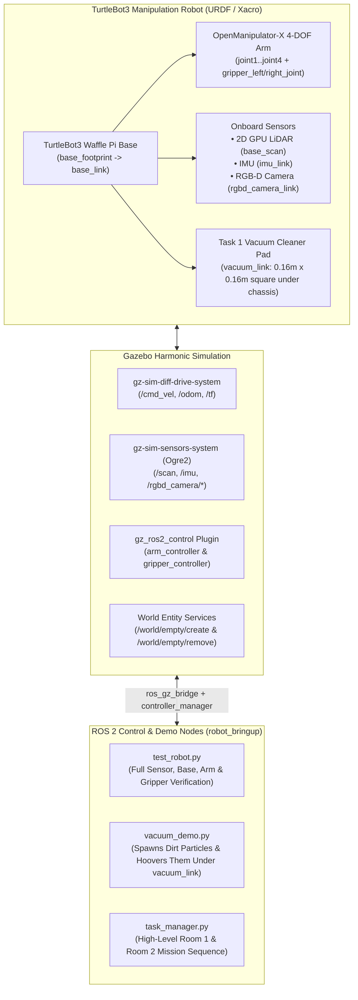

# Robot Simulation with ROS 2 Jazzy + Gazebo Harmonic 

A modular **ROS 2** and **Gazebo Harmonic** simulation project featuring a **TurtleBot3 Manipulation** robot (a differential-drive **TurtleBot3 Waffle Pi** base with an **OpenManipulator-X** 4-DOF arm and parallel-jaw gripper) equipped with a 2D GPU LiDAR, IMU, and an RGB-D camera. This environment is designed to support intelligent robotics tasks such as SLAM map generation, autonomous navigation, vacuum cleaning, and object pick-up.


## 1. File Structure and Purpose

```text
.gitignore                        # Version control ignore rules for build, log, and cache artifacts
README.md                         # Complete project documentation and guide
turtlebot3_manipulation.repos     # Repository list for cloning ROBOTIS TurtleBot3 Manipulation packages
src/
├── turtlebot3_manipulation/      # Cloned ROBOTIS TurtleBot3 Manipulation packages (jazzy branch)
│
└── robot_bringup/                # Main ROS 2 package root
    ├── config/
    │   ├── bridge_params.yaml    # Maps Gazebo transport topics to ROS 2 topics
    │   └── ros2_controllers.yaml # Configuration parameters for ros2_control arm & gripper controllers
    │
    ├── launch/
    │   └── simulation.launch.py  # Python launch file to start Gazebo, spawn robot, controllers, and ROS 2 bridge
    │
    ├── resource/                 # (EXPLAIN HERE)
    │
    ├── robot_bringup/            # Inner Python module directory (required for Python packaging)
    │   ├── __init__.py           # Python package marker (tells Python this folder is an importable package)
    │   ├── task_manager.py       # High-level task logic node (Room 1 vacuuming & Room 2 pick-up)
    │   ├── test_robot.py
    │   └── vacuum_demo.py
    │
    ├── test/                     # Template test modules (NOT YET MODIFIED)
    │
    ├── urdf/
    │   ├── turtlebot3_manipulation.urdf.xacro         # Master URDF/Xacro combining Waffle Pi, OpenManipulator-X, and RGB-D camera
    │   ├── turtlebot3_manipulation_gz.xacro           # Gazebo Harmonic friction, sensors (LiDAR, RGB-D, IMU), and plugins
    │   └── turtlebot3_manipulation.ros2_control.xacro # gz_ros2_control hardware interfaces for arm and gripper joints
    │
    ├── package.xml               # ROS 2 package manifest, dependencies, and maintainer info
    ├── setup.cfg                 # Configures custom installation script paths ($base/lib/robot_bringup)
    └── setup.py                  # Python setuptools installation script for resource indexing and binaries
```

Our robot_bringup package was created using standard the ROS 2 CLI command `ros2 pkg create` with the `ament_python` template:

```bash
ros2 pkg create --build-type ament_python robot_bringup --dependencies rclpy geometry_msgs sensor_msgs nav2_msgs
```

**Build System:** **`colcon`** (Collection Construct), the standard meta-build tool for ROS 2 workspaces, using symbolic links (`--symlink-install`) so configuration and model files update dynamically without requiring a full rebuild.


## 2. High-Level Architecture Overview

Our project requires a single mobile manipulator capable of:
1. **Mapping & Navigation:** Exploring an unknown multi-room environment using 2D LiDAR + wheel odometry + IMU.
2. **Room Identification:** Recognising room wall/floor colours (Blue vs. Green) and detecting objects using a front-mounted RGB-D camera.
3. **Task 1 (Vacuum Cleaning in Room 1):** Sweeping the floor with an under-chassis vacuum attachment and hoovering up dirt particles.
4. **Task 2 (Object Pick-and-Place in Room 2):** Reaching, grasping, lifting, and relocating objects using a 4-DOF manipulator arm and parallel-jaw gripper.




## 3. System Requirements

Before running the project, make sure you have installed Gazebo Harmonic and ROS 2 Jazzy, this project has been developed to work on Ubuntu 24.04 LTS (including WSL2 Ubuntu 24.04):

* **Operating System:** Ubuntu 24.04 (Noble Numbat)
* **ROS 2 Distribution:** ROS 2 Jazzy Jalisco
* **Gazebo Harmonic** (native simulator for ROS 2 Jazzy)
* **Core ROS 2 APT Packages:**
  * `ros-jazzy-ros-gz`
  * `ros-jazzy-gz-ros2-control`
  * `ros-jazzy-ros2-control`
  * `ros-jazzy-ros2-controllers`
  * `ros-jazzy-xacro`
  * `ros-jazzy-robot-state-publisher`
  * `ros-jazzy-dynamixel-sdk`
  * `ros-jazzy-turtlebot3-msgs`
  * `ros-jazzy-slam-toolbox`
  * `ros-jazzy-navigation2`
  * `ros-jazzy-nav2-bringup`
* **Source ROS 2 Package (cloned into `src/`):**
  * `ROBOTIS-GIT/turtlebot3_manipulation` (`jazzy` branch — provides `turtlebot3_manipulation_description` meshes and xacro macros, which are not distributed as `apt` binaries on Jazzy)
* **Python Version:** Python 3.10+ (if you have installed the above on Ubuntu, this should already be sorted)


## 4. How to Run the Project for the First Time

Follow these steps in your terminal to build and execute the simulation:

### Step 1: Clone project

Clone the project:

```bash
git clone https://github.com/ChrisDev18/intelligent-robotics-project.git
```

### Step 2: Install Required ROS 2 Jazzy Packages

Install the required ROS 2 Jazzy simulation and control packages via `apt`:

```bash
sudo apt update
sudo apt install -y \
  ros-jazzy-ros-gz \
  ros-jazzy-gz-ros2-control \
  ros-jazzy-ros2-control \
  ros-jazzy-ros2-controllers \
  ros-jazzy-xacro \
  ros-jazzy-robot-state-publisher \
  ros-jazzy-dynamixel-sdk \
  ros-jazzy-turtlebot3-msgs \
  ros-jazzy-slam-toolbox \
  ros-jazzy-navigation2 \
  ros-jazzy-nav2-bringup
```

### Step 3: Clone TurtleBot3 Manipulation Description 

The official ROBOTIS `turtlebot3_manipulation` ROS package cannot be installed with `apt`, so it needs to be cloned directly from its git repo and placed as a ROS pacakge in the project's `src` directory:

```bash
cd intelligent-robotics-project
git clone -b jazzy https://github.com/ROBOTIS-GIT/turtlebot3_manipulation.git src/turtlebot3_manipulation
```

### Step 4: Initialise ROS 2

Initialise ROS 2 - this must be done in any terminal you are using (including new ones):

```bash
source /opt/ros/jazzy/setup.bash
```

### Step 5: Build the Workspace

Build the description and bringup packages in the workspace (using symbolic links so configuration changes take effect instantly):

```bash
colcon build --symlink-install --packages-select turtlebot3_manipulation_description robot_bringup
```

### Step 6: Source Your Workspace Environment

Initialise your project in your terminal session - this must be done in any terminal you are using (including new ones):

```bash
source install/setup.bash
```

### Step 7: Launch the Simulation

Start Gazebo Harmonic, spawn the TurtleBot3 Manipulation robot, activate the arm/gripper controllers, and fire up the ROS 2 bridge:

```bash
ros2 launch robot_bringup simulation.launch.py
```

> [!NOTE]
> Wait from 5 to 20 seconds after Gazebo opens to let Ogre/Ogre2 compile the GPU LiDAR/RGB-D shaders. The `arm_controller` and `gripper_controller` will print `Configured and activated` in the terminal once the simulation is ready.

You should see Gazebo open with an empty world and your TurtleBot3 Waffle Pi with the OpenManipulator-X arm and RGB-D camera spawned inside it.

> [!TIP]
> For more help/information about getting the simulation to start and work properly, check out **[the troubleshooting guide](docs/troubleshooting.md)**.


### Step 7: Run the demonstrations

**In another terminal**, source ROS 2 and your workspace, and run a demonstration of your choice:

> [!NOTE]
> With any new terminal, remember to reinitialise ROS 2 and the project via:
>
> ```bash
> source /opt/ros/jazzy/setup.bash
> source install/setup.bash
> ```

1. **Task 1 Vacuum Cleaner & Dirt Hoovering Demo:**
   ```bash
   ros2 run robot_bringup vacuum_demo
   ```
   *Spawns 8 brown dirt particles in front of the robot, turns on the vacuum, drives over them, and deletes each particle in Gazebo as the blue square vacuum pad passes over it.*

2. **Full Robot Sensor, Base, Arm & Gripper Test:**
   ```bash
   ros2 run robot_bringup test_robot
   ```
   *Drives the base forward/backward, rotates left/right, moves the 4-DOF OpenManipulator-X arm through a reach-and-lift sequence, opens/closes the gripper, and prints a `[OK]` checklist for all 6 sensors.*

3. **High-Level Mission Sequence (Room 1 + Room 2 Skeleton):**
   ```bash
   ros2 run robot_bringup task_manager
   ```
   *Not yet properly implemented or tested*

4. **Run SLAM visualisation**
   ```bash
   ros2 launch slam_toolbox online_async_launch.py use_sim_time:=true
   ```
   *Not yet properly implemented or tested*


## 5. Runtime Artifacts & Generated Files

When you run `colcon build` and launch the project for the first time, ROS 2 and Gazebo generate several directories and runtime files outside the `src` directory:

* **`build/` (Workspace Root):** Contains intermediate build files, CMake/colcon cache logs, and Python egg-info metadata generated during compilation.
* **`install/` (Workspace Root):** The destination where built packages, symbolic links, share paths, and executables are deployed.
* **`log/` (Workspace Root):** Stores detailed execution logs for every ROS 2 node (`ros2 run`, launch files) and daemon for debugging node lifecycles.
* **Gazebo Cache (`~/.cache/gazebosim/` & `~/.ignition/`):** Gazebo downloads standard world files (like `empty.sdf`) and caches physics shaders here upon initial launch.
