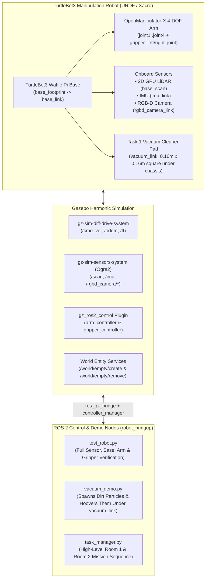

# Robot Simulation with ROS 2 Jazzy + Gazebo Harmonic 

A modular **ROS 2** and **Gazebo Harmonic** simulation project featuring a **TurtleBot3 Manipulation** robot (a differential-drive **TurtleBot3 Waffle Pi** base with an **OpenManipulator-X** 4-DOF arm and parallel-jaw gripper) equipped with a 2D GPU LiDAR, IMU, and an RGB-D camera. This environment is designed to support intelligent robotics tasks such as SLAM map generation, autonomous navigation, vacuum cleaning, and object pick-up.


## 1. File Structure and Purpose

```text
.gitignore                        # Version control ignore rules for build, log, and cache artifacts
README.md                         # Complete project documentation and guide
docs/                             # Additional project guides and documentation
src/
├── turtlebot3_manipulation/      # Cloned ROBOTIS TurtleBot3 Manipulation packages (jazzy branch, gitignored)
│
└── robot_bringup/                # Unified ROS 2 ament_python package
    ├── config/
    │   ├── bridge_params.yaml    # Maps Gazebo transport topics/services to ROS 2
    │   ├── ros2_controllers.yaml # Configuration parameters for ros2_control arm & gripper controllers
    │   └── slam_toolbox.yaml     # Online async SLAM Toolbox parameters for the home world
    │
    ├── launch/
    │   ├── explore.launch.py     # Live SLAM + Nav2 + autonomous frontier exploration
    │   ├── nav.launch.py         # Nav2 + AMCL navigation on a saved map
    │   ├── robot_in_home.launch.py # Spawn TurtleBot3 Manipulation in home world (humans/no_humans/tasks)
    │   ├── simulation.launch.py  # Core Gazebo Harmonic, URDF, controllers, and ROS 2 bridge
    │   ├── slam.launch.py        # Manual SLAM mapping + RViz
    │   └── world.launch.py       # Standalone home world + /clock bridge
    │
    ├── maps/                     # Saved SLAM occupancy maps (home_map.*, explored_map.*)
    │
    ├── resource/
    │   └── robot_bringup         # ament index package resource marker
    │
    ├── robot_bringup/            # Inner Python module directory (all ROS 2 console_scripts)
    │   ├── __init__.py           # Python package marker
    │   ├── alpha_cleaning.py     # Phase C: Room 1 (Alpha) vacuum cleaning task node
    │   ├── beta_pick_place.py    # Phase D: Room 2 (Beta) object pick-and-place task node
    │   ├── doorway_navigator.py  # Room floor-color discovery + Nav2 doorway handoff controller
    │   ├── frontier_explorer.py  # Autonomous SLAM frontier exploration (/exploration_done, /exploration_pause)
    │   ├── save_map.py           # Live /map saver node (.pgm + .yaml)
    │   ├── task_manager.py       # High-level autonomous mission executive
    │   ├── test_robot.py         # Full sensor, base, arm & gripper verification node
    │   └── vacuum_demo.py        # Standalone vacuum cleaner & dirt-hoovering demo
    │
    ├── rviz/
    │   └── slam.rviz             # RViz2 layout for SLAM mapping
    │
    ├── test/                     # Standard ament_python template linter tests
    │
    ├── tools/                    # Offline non-ROS CLI scripts
    │   ├── generate_world.py     # Generates worlds/home.sdf & worlds/home_no_humans.sdf
    │   ├── make_task_world.py    # Generates worlds/home_tasks.sdf from home_no_humans.sdf
    │   ├── summarize_alpha_eval.py # Aggregates Alpha cleaning evaluation CSV logs
    │   └── summarize_beta_eval.py  # Aggregates Beta pick-and-place evaluation CSV logs
    │
    ├── urdf/
    │   ├── turtlebot3_manipulation.urdf.xacro         # Master URDF/Xacro combining Waffle Pi, OpenManipulator-X, RGB-D camera & vacuum pad
    │   ├── turtlebot3_manipulation_gz.xacro           # Gazebo Harmonic friction, sensors (LiDAR, RGB-D, IMU), DetachableJoint & plugins
    │   └── turtlebot3_manipulation.ros2_control.xacro # gz_ros2_control hardware interfaces for arm and gripper joints
    │
    ├── worlds/                   # Generated Gazebo Harmonic SDF worlds
    │   ├── home.sdf              # Hall + Room 1 Alpha + Room 2 Beta with furniture & 3 walking humans
    │   ├── home_no_humans.sdf    # Same world without humans (used for SLAM mapping)
    │   └── home_tasks.sdf        # Stripped-down walls/floors + Beta cube practice world
    │
    ├── LICENSE                   # Apache-2.0 license
    ├── package.xml               # ROS 2 package manifest & complete audited dependencies
    ├── setup.cfg                 # Configures script installation paths ($base/lib/robot_bringup)
    └── setup.py                  # Python setuptools install script for share assets and console_scripts
```

Our `robot_bringup` package follows the standard ROS 2 CLI `ament_python` template created with `ros2 pkg create`:

```bash
ros2 pkg create --build-type ament_python robot_bringup \
  --license Apache-2.0 \
  --dependencies \
    rclpy ament_index_python launch launch_ros python3-numpy \
    builtin_interfaces std_msgs geometry_msgs sensor_msgs nav_msgs rosgraph_msgs \
    tf2_msgs tf2_ros trajectory_msgs control_msgs nav2_msgs ros_gz_interfaces \
    turtlebot3_manipulation_description xacro robot_state_publisher \
    ros_gz_sim ros_gz_bridge gz_ros2_control controller_manager \
    ros2_controllers joint_state_broadcaster joint_trajectory_controller gripper_controllers \
    slam_toolbox nav2_bringup nav2_common nav2_simple_commander \
    nav2_controller nav2_smoother nav2_planner nav2_behaviors \
    nav2_velocity_smoother nav2_collision_monitor nav2_bt_navigator \
    nav2_waypoint_follower nav2_lifecycle_manager nav2_map_server \
    rviz2 teleop_twist_keyboard
```

**Build System:** **`colcon`** (Collection Construct), the standard meta-build tool for ROS 2 workspaces, using symbolic links (`--symlink-install`) so configuration and model files update dynamically without requiring a full rebuild.


## 2. High-Level Architecture Overview

Our project requires a single mobile manipulator capable of:
1. **Mapping & Navigation:** Exploring an unknown multi-room environment using 2D LiDAR + wheel odometry + IMU.
2. **Room Identification:** Recognising room wall/floor colours (Blue vs. Green) and detecting objects using a front-mounted RGB-D camera.
3. **Task 1 (Vacuum Cleaning in Room 1):** Sweeping the floor with an under-chassis vacuum attachment and hoovering up dirt particles.
4. **Task 2 (Object Pick-and-Place in Room 2):** Reaching, grasping, lifting, and relocating objects using a 4-DOF manipulator arm and parallel-jaw gripper.




## 3. System Requirements

Before running the project, make sure you have installed Gazebo Harmonic and ROS 2 Jazzy, this project has been developed to work on Ubuntu 24.04 LTS (including WSL2 Ubuntu 24.04):

* **Operating System:** Ubuntu 24.04 (Noble Numbat)
* **ROS 2 Distribution:** ROS 2 Jazzy Jalisco
* **Gazebo Harmonic** (native simulator for ROS 2 Jazzy)
* **Core ROS 2 APT Packages:**
  * `ros-jazzy-ros-gz`
  * `ros-jazzy-gz-ros2-control`
  * `ros-jazzy-ros2-control`
  * `ros-jazzy-ros2-controllers`
  * `ros-jazzy-xacro`
  * `ros-jazzy-robot-state-publisher`
  * `ros-jazzy-dynamixel-sdk`
  * `ros-jazzy-turtlebot3-msgs`
  * `ros-jazzy-slam-toolbox`
  * `ros-jazzy-navigation2`
  * `ros-jazzy-nav2-bringup`
* **Source ROS 2 Package (cloned into `src/`):**
  * `ROBOTIS-GIT/turtlebot3_manipulation` (`jazzy` branch — provides `turtlebot3_manipulation_description` meshes and xacro macros, which are not distributed as `apt` binaries on Jazzy)
* **Python Version:** Python 3.10+ (if you have installed the above on Ubuntu, this should already be sorted)


## 4. How to Run the Project for the First Time

Follow these steps in your terminal to build and execute the simulation:

### Step 1: Clone project

Clone the project:

```bash
git clone https://github.com/ChrisDev18/intelligent-robotics-project.git
```

### Step 2: Install Required ROS 2 Jazzy Packages

Install the required ROS 2 Jazzy simulation and control packages via `apt`:

```bash
sudo apt update
sudo apt install -y \
  ros-jazzy-ros-gz \
  ros-jazzy-gz-ros2-control \
  ros-jazzy-ros2-control \
  ros-jazzy-ros2-controllers \
  ros-jazzy-xacro \
  ros-jazzy-robot-state-publisher \
  ros-jazzy-dynamixel-sdk \
  ros-jazzy-turtlebot3-msgs \
  ros-jazzy-slam-toolbox \
  ros-jazzy-navigation2 \
  ros-jazzy-nav2-bringup
```

### Step 3: Clone TurtleBot3 Manipulation Description 

The official ROBOTIS `turtlebot3_manipulation` ROS package cannot be installed with `apt`, so it needs to be cloned directly from its git repo and placed as a ROS pacakge in the project's `src` directory:

```bash
cd intelligent-robotics-project
git clone -b jazzy https://github.com/ROBOTIS-GIT/turtlebot3_manipulation.git src/turtlebot3_manipulation
```

### Step 4: Initialise ROS 2

Initialise ROS 2 - this must be done in any terminal you are using (including new ones):

```bash
source /opt/ros/jazzy/setup.bash
```

### Step 5: Build the Workspace

Build the description and bringup packages in the workspace (using symbolic links so configuration changes take effect instantly):

```bash
colcon build --symlink-install --packages-select turtlebot3_manipulation_description robot_bringup
```

### Step 6: Source Your Workspace Environment

Initialise your project in your terminal session - this must be done in any terminal you are using (including new ones):

```bash
source install/setup.bash
```

### Step 7: Launch the Simulation

Start Gazebo Harmonic, spawn the TurtleBot3 Manipulation robot, activate the arm/gripper controllers, and fire up the ROS 2 bridge:

```bash
ros2 launch robot_bringup simulation.launch.py
```

> [!NOTE]
> Wait from 5 to 20 seconds after Gazebo opens to let Ogre/Ogre2 compile the GPU LiDAR/RGB-D shaders. The `arm_controller` and `gripper_controller` will print `Configured and activated` in the terminal once the simulation is ready.

You should see Gazebo open with an empty world and your TurtleBot3 Waffle Pi with the OpenManipulator-X arm and RGB-D camera spawned inside it.

> [!TIP]
> For more help/information about getting the simulation to start and work properly, check out **[the troubleshooting guide](docs/troubleshooting.md)**.


### Step 7: Run the demonstrations

**In another terminal**, source ROS 2 and your workspace, and run a demonstration of your choice:

> [!NOTE]
> With any new terminal, remember to reinitialise ROS 2 and the project via:
>
> ```bash
> source /opt/ros/jazzy/setup.bash
> source install/setup.bash
> ```

1. **Task 1 Vacuum Cleaner & Dirt Hoovering Demo:**
   ```bash
   ros2 run robot_bringup vacuum_demo
   ```
   *Spawns 8 brown dirt particles in front of the robot, turns on the vacuum, drives over them, and deletes each particle in Gazebo as the blue square vacuum pad passes over it.*

2. **Full Robot Sensor, Base, Arm & Gripper Test:**
   ```bash
   ros2 run robot_bringup test_robot
   ```
   *Drives the base forward/backward, rotates left/right, moves the 4-DOF OpenManipulator-X arm through a reach-and-lift sequence, opens/closes the gripper, and prints a `[OK]` checklist for all 6 sensors.*

3. **High-Level Mission Sequence (Room 1 + Room 2 Skeleton):**
   ```bash
   ros2 run robot_bringup task_manager
   ```
   *Not yet properly implemented or tested*

4. **Run SLAM visualisation**
   ```bash
   ros2 launch slam_toolbox online_async_launch.py use_sim_time:=true
   ```
   *Not yet properly implemented or tested*


## 5. Runtime Artifacts & Generated Files

When you run `colcon build` and launch the project for the first time, ROS 2 and Gazebo generate several directories and runtime files outside the `src` directory:

* **`build/` (Workspace Root):** Contains intermediate build files, CMake/colcon cache logs, and Python egg-info metadata generated during compilation.
* **`install/` (Workspace Root):** The destination where built packages, symbolic links, share paths, and executables are deployed.
* **`log/` (Workspace Root):** Stores detailed execution logs for every ROS 2 node (`ros2 run`, launch files) and daemon for debugging node lifecycles.
* **Gazebo Cache (`~/.cache/gazebosim/` & `~/.ignition/`):** Gazebo downloads standard world files (like `empty.sdf`) and caches physics shaders here upon initial launch.


---

## Teammate Task Integration (Room 1 Cleaning & Room 2 Pick-and-Place)

### 1. First-Time Setup & World Generation
- Generate worlds (furniture/obstacles + humans, no-humans for SLAM, and task practice world):
  ```bash
  python3 src/robot_bringup/tools/generate_world.py
  python3 src/robot_bringup/tools/make_task_world.py
  ```
- Source ROS 2 Jazzy: `source /opt/ros/jazzy/setup.bash`
- Build: `colcon build --symlink-install --packages-select turtlebot3_manipulation_description robot_bringup && source install/setup.bash`

### 2. Home World Coordinates
Origin `(0, 0)` = bottom-left outer corner, `x` east, `y` north (metres).

| Item | World Position |
|---|---|
| Door 1 (Alpha) | `x` 4.0–5.2, `y` 7.0 |
| Door 2 (Beta) | `x` 14.8–16.0, `y` 7.0 |
| Robot spawn | `(19.21, 0.79)`, yaw `1.5708` |
| Alpha clean zone | centre `(6.79, 9.14)`, `2.29 × 1.57 m` |
| Beta pick item | `(12.86, 8.21)`, `0.15 m` cube, `0.2 kg` |
| Beta drop spot | `(18.98, 9.30)` |

### 3. ROS 2 Mission Handoff Flags & Topics
- **Exploration / SLAM Mapping (`frontier_explorer`):**
  - Subscribes to `/exploration_pause` (`std_msgs/msg/Bool`) to pause/resume exploration
  - Publishes `True` to `/exploration_done` (`std_msgs/msg/Bool`, `TRANSIENT_LOCAL` QoS) when mapping is complete
  - Save the live map with `ros2 run robot_bringup save_map src/robot_bringup/maps/explored_map`
- **Room 1 (Alpha — Yellow Floor, Vacuum Cleaning):**
  - Subscribe to `/room1/ready` (`std_msgs/msg/Bool`, `TRANSIENT_LOCAL` QoS)
  - Publish `True` to `/room1/done` (`std_msgs/msg/Bool`, `TRANSIENT_LOCAL` QoS) when finished
  - Controls: `/vacuum/active` (`Bool`), `/cmd_vel` (`Twist`), `navigate_to_pose`, `/world/empty/create` & `/world/empty/remove`
- **Room 2 (Beta — Mint/Green Floor, Pick & Place):**
  - Subscribe to `/room2/ready` (`std_msgs/msg/Bool`, `TRANSIENT_LOCAL` QoS)
  - Publish `True` to `/room2/done` (`std_msgs/msg/Bool`, `TRANSIENT_LOCAL` QoS) when finished
  - Controls: `/rgbd_camera/image`, `/rgbd_camera/depth_image`, `/arm_controller/joint_trajectory` (`joint1`..`joint4`), `/gripper_controller/gripper_cmd` (`0.018` open / `-0.005` close), `/beta_pick_item/attach` & `/beta_pick_item/detach`

### 4. Running Together
- **Standalone Home World:** `ros2 launch robot_bringup world.launch.py` (or `humans:=false`)
- **Manual SLAM Mapping:** `ros2 launch robot_bringup slam.launch.py`
- **Saved-Map Nav2 Navigation:** `ros2 launch robot_bringup nav.launch.py` (add `humans:=true` for walking humans)
- **Full Autonomous Exploration + Room Task Handoff:**
  - Terminal 1: `ros2 launch robot_bringup explore.launch.py humans:=false return_home:=false`
  - Terminal 2: `ros2 run robot_bringup doorway_navigator --ros-args -p wait_for_teammates:=true`
  - Terminal 3: `ros2 run robot_bringup alpha_cleaning --ros-args -p wait_for_ready:=true`
  - Terminal 4: `ros2 run robot_bringup beta_pick_place --ros-args -p wait_for_ready:=true`
