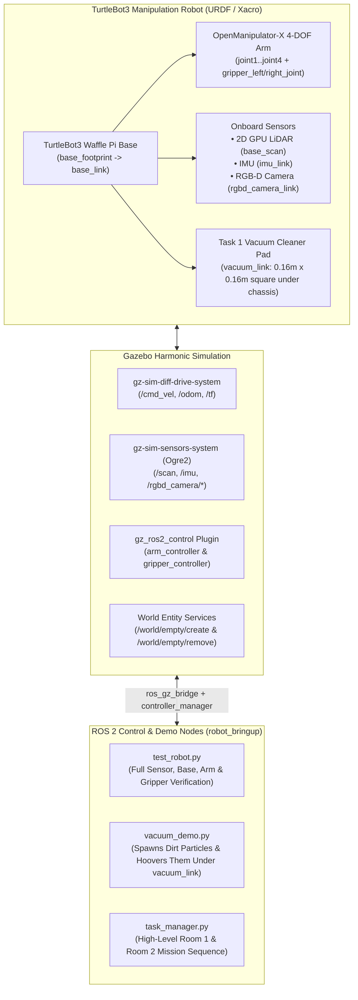

# TurtleBot3 Manipulation, Sensors & Vacuum System — Technical Guide

This document explains everything that has been built, configured, and fixed for our TurtleBot3 Manipulation robot in ROS 2 Jazzy and Gazebo Harmonic, including the TurtleBot3 Waffle Pi mobile base, the OpenManipulator 4-DOF arm and parallel-jaw gripper, the onboard perception sensors, and the Task 1 under-chassis vacuum cleaner and dirt-hoovering system.

---

## 1. High-Level Architecture Overview

Our project requires a single mobile manipulator capable of:
1. **Mapping & Navigation:** Exploring an unknown multi-room environment using 2D LiDAR + wheel odometry + IMU.
2. **Room Identification:** Recognising room wall/floor colours (Blue vs. Green) and detecting objects using a front-mounted RGB-D camera.
3. **Task 1 (Room 1 — Vacuum Cleaning):** Sweeping the floor with an under-chassis vacuum attachment and hoovering up dirt particles.
4. **Task 2 (Room 2 — Object Pick-and-Place):** Reaching, grasping, lifting, and relocating objects using a 4-DOF manipulator arm and parallel-jaw gripper.



---

## 2. Everything Added & Why It Was Added

### 2.1 Composite Robot Description (`urdf/turtlebot3_manipulation.urdf.xacro`)
* **What it does:** Combines the official ROBOTIS **TurtleBot3 Waffle Pi** mobile base (`turtlebot3_waffle_pi.urdf.xacro`) and **OpenManipulator-X** arm (`open_manipulator_x.urdf.xacro`) with our project-specific hardware additions into one unified URDF model.
* **Why we built a custom composite Xacro:**
  * The upstream `turtlebot3_manipulation_description` package provides the base and arm meshes/macros, but targets older Gazebo Classic setups and does not include a front RGB-D camera or a vacuum cleaner attachment.
  * By assembling the robot in `robot_bringup/urdf/turtlebot3_manipulation.urdf.xacro`, we keep the upstream ROBOTIS package clean while adding:
    1. **`rgbd_camera_link` & `rgbd_camera_optical_frame`** at `xyz="0.073 0.0 0.084"` on the front of the chassis for room colour recognition and object detection.
    2. **`vacuum_link` & `vacuum_joint`** at `xyz="-0.040 0.0 -0.005"` on the underside of `base_link` to represent the Task 1 vacuum cleaner head.
* **Materials Path Fix:**
  * Upstream ROBOTIS places `materials.xacro` inside `turtlebot3_manipulation_description/gazebo/materials.xacro` (not `urdf/materials.xacro`). We updated the `<xacro:include>` path so `xacro` compiles cleanly on every machine.

---

### 2.2 Gazebo Harmonic Physics, Sensors & Plugins (`urdf/turtlebot3_manipulation_gz.xacro`)
* **What it does:** Configures Gazebo Harmonic (`gz-sim8`) surface friction parameters, sensor plugins, differential-drive kinematics, and the `gz_ros2_control` plugin.
* **Key Subsystems Configured:**
  1. **Wheel & Gripper Friction (`<mu1>`, `<mu2>`, `<kp>`, `<kd>`):** High friction (`10000.0` on drive wheels, `100.0` on gripper fingers) and low friction (`0.01`) on the rear casters so the robot drives without slipping and holds grasped objects firmly.
  2. **2D GPU LiDAR (`lds_lfcd_sensor` on `base_scan`):** $360^\circ$ scan, $0.12\text{ m} \to 10.0\text{ m}$ range at $10\text{ Hz}$, publishing to `/scan`.
  3. **IMU (`tb3_imu` on `imu_link`):** $100\text{ Hz}$ angular velocity and linear acceleration with realistic Gaussian noise, publishing to `/imu`.
  4. **Front RGB-D Camera (`rgbd_camera` on `rgbd_camera_link`):** $640 \times 480$ RGB image, depth image, camera info, and 3D point cloud at $15\text{ Hz}$, publishing to `/rgbd_camera/*`.
  5. **Differential Drive (`gz-sim-diff-drive-system`):** Subscribes to `/cmd_vel` and publishes wheel odometry (`/odom`) and `/tf` (`odom` $\rightarrow$ `base_footprint`) at $50\text{ Hz}$.

---

### 2.3 OpenManipulator-X Arm & Gripper Control (`urdf/turtlebot3_manipulation.ros2_control.xacro` & `config/ros2_controllers.yaml`)
* **What it does:** Bridges the 4 arm revolute joints (`joint1`, `joint2`, `joint3`, `joint4`) and the parallel-jaw prismatic gripper joints (`gripper_left_joint`, `gripper_right_joint`) into `ros2_control`.
* **How the Controllers Work:**
  * **`joint_state_broadcaster`:** Publishes all joint positions and velocities to `/joint_states`.
  * **`arm_controller` (`joint_trajectory_controller/JointTrajectoryController`):** Accepts position trajectories on `/arm_controller/joint_trajectory` (topic) and `/arm_controller/follow_joint_trajectory` (action).
  * **`gripper_controller` (`position_controllers/GripperActionController`):** Accepts parallel-jaw opening/closing goals on `/gripper_controller/gripper_cmd` (`control_msgs/action/GripperCommand`).
    * Positive position (e.g., `+0.018` m) **opens** the gripper jaws.
    * Negative/zero position (e.g., `-0.005` m) **closes** the gripper jaws.
* **Important ROS 2 Jazzy Mimic Joint Fix:**
  * On the OpenManipulator-X, `gripper_right_joint` physically mirrors `gripper_left_joint` via `<mimic joint="gripper_left_joint" multiplier="1"/>`.
  * Newer versions of `ros2_control` in ROS 2 Jazzy strictly forbid `<command_interface>` tags on mimic joints and will abort the entire hardware interface if one is present.
  * **Fix applied:** `gripper_left_joint` has both `<command_interface name="position"/>` and `<state_interface>` tags, while `gripper_right_joint` has `<param name="mimic">gripper_left_joint</param>` and **only** `<state_interface>` tags.

---

### 2.4 Task 1 Vacuum Cleaner Attachment & Dirt Hoovering System

#### Why a Visual-Only Square Pad Under `base_link`?
* **Geometry of the Waffle Pi Base:**
  * `base_footprint` sits on the floor at $z = 0.0\text{ m}$.
  * `base_link` is mounted $10\text{ mm}$ above the floor ($z = +0.010\text{ m}$), with the bottom of the chassis box at $z = 0.0\text{ m}$ in `base_link` coordinates.
  * The left and right drive wheels are at $y = \pm 0.144\text{ m}$ and the rear caster is at $x = -0.177\text{ m}$.
* **Vacuum Pad Design (`vacuum_link`):**
  * Attached to `base_link` via a fixed joint (`vacuum_joint`) at `xyz="-0.040 0.0 -0.005"`.
  * Uses a **cyan-blue square box `<visual>`** of size **`0.160 m x 0.160 m x 0.006 m`** ($16\text{ cm} \times 16\text{ cm}$ square, $6\text{ mm}$ thick), hovering $2\text{ mm}$ above the floor plane.
  * Includes a lightweight `<inertial>` tag ($1\text{ g}$) so Gazebo's URDF-to-SDF converter preserves the link frame, while **intentionally omitting `<collision>`** so the vacuum pad never drags on the ground or reduces wheel traction.

#### How the Dirt Hoovering Demo Works (`robot_bringup/vacuum_demo.py`)
1. **Bridged Gazebo World Services (`config/bridge_params.yaml`):**
   * We bridged Gazebo Harmonic's entity creation and deletion services into ROS 2:
     * `/world/empty/create` (`ros_gz_interfaces/srv/SpawnEntity`)
     * `/world/empty/remove` (`ros_gz_interfaces/srv/DeleteEntity`)
2. **Spawning Dirty Particles:**
   * When `ros2 run robot_bringup vacuum_demo` starts, it reads the robot's current pose $(x_0, y_0, \theta_0)$ from `/odom`.
   * It spawns **8 brown/dark-orange disc models** (`dirt_particle_1` .. `dirt_particle_8`, radius $2.5\text{ cm}$, thickness $4\text{ mm}$) in a staggered patch on the floor directly ahead of the robot ($0.14\text{ m}$ to $0.56\text{ m}$ forward, $\pm 0.04\text{ m}$ lateral).
   * Each dirt particle is `<static>true</static>` with `<visual>` geometry only (no `<collision>`), so the robot drives smoothly over them without physical bumping.
3. **Real-Time Square Footprint Tracking & Hoovering:**
   * As the robot drives forward over the dirty patch (`linear.x = 0.20 m/s`), the node continuously computes the world coordinates $(x_{\text{vac}}, y_{\text{vac}})$ of the centre of `vacuum_link` from `/odom`:
     $$x_{\text{vac}} = x_{\text{robot}} - 0.040 \cos(\theta), \qquad y_{\text{vac}} = y_{\text{robot}} - 0.040 \sin(\theta)$$
   * Each remaining dirt particle's position $(x_p, y_p)$ is transformed into `vacuum_link`'s local square coordinate frame $(\Delta x_{\text{local}}, \Delta y_{\text{local}})$:
     $$\Delta x_{\text{local}} = (x_p - x_{\text{vac}})\cos(\theta) + (y_p - y_{\text{vac}})\sin(\theta)$$
     $$\Delta y_{\text{local}} = -(x_p - x_{\text{vac}})\sin(\theta) + (y_p - y_{\text{vac}})\cos(\theta)$$
   * Whenever $|\Delta x_{\text{local}}| \le 0.080 + r_{\text{dirt}}$ and $|\Delta y_{\text{local}}| \le 0.080 + r_{\text{dirt}}$ (meaning the particle is underneath the $16\text{ cm} \times 16\text{ cm}$ square vacuum pad), the node **hoovers it up**:
     * Calls `/world/empty/remove` (`DeleteEntity`) asynchronously so the particle immediately vanishes in Gazebo.
     * Logs the live cleaning progress (`Cleaned: k/8 (%)`).

---

## 3. Summary of Files Modified & Added

| File | Role / What Changed |
| :--- | :--- |
| `src/robot_bringup/urdf/turtlebot3_manipulation.urdf.xacro` | Fixed `materials.xacro` include path; added `rgbd_camera_link` and under-chassis `vacuum_link` ($0.16 \times 0.16 \times 0.006\text{ m}$ square visual pad). |
| `src/robot_bringup/urdf/turtlebot3_manipulation_gz.xacro` | Added cyan-blue Gazebo visual material for `vacuum_link`; configured LiDAR, IMU, RGB-D camera, `DiffDrive`, and `gz_ros2_control`. |
| `src/robot_bringup/urdf/turtlebot3_manipulation.ros2_control.xacro` | Fixed ROS 2 Jazzy mimic joint error by removing `<command_interface>` from `gripper_right_joint`. |
| `src/robot_bringup/config/bridge_params.yaml` | Bridged `/clock`, `/cmd_vel`, `/odom`, `/tf`, `/joint_states`, `/scan`, `/imu`, `/rgbd_camera/*`, plus `/world/empty/create` and `/world/empty/remove` services. |
| `src/robot_bringup/launch/simulation.launch.py` | Added `--switch-timeout 30.0` to controller spawners so laptops with integrated GPUs (e.g. WSL2) have plenty of time to initialise Ogre2 shaders without timing out. |
| `src/robot_bringup/robot_bringup/vacuum_demo.py` | **New node:** Spawns 8 dirty particles on the floor ahead of the robot and hoovers (deletes) them in real time as `vacuum_link` passes over them. |
| `src/robot_bringup/robot_bringup/test_robot.py` | **Verification node:** Tests all 6 sensor streams (`scan`, `odom`, `imu`, `rgb_image`, `depth_image`, `joint_states`), drives/turns the base, moves the 4-DOF arm, and opens/closes the gripper. |
| `src/robot_bringup/robot_bringup/task_manager.py` | Added `set_vacuum(True/False)` and `/vacuum/active` topic publishing to the high-level mission node. |
| `src/robot_bringup/package.xml` & `setup.py` | Added `std_msgs` and `ros_gz_interfaces` dependencies and registered the `vacuum_demo`, `test_robot`, and `task_manager` console scripts. |

---

## 4. How to Build & Run Everything

### Step 1: Build the Workspace
Run this from the root of the repository (`intelligent-robotics-project`):
```bash
source /opt/ros/jazzy/setup.bash
colcon build --symlink-install --packages-select turtlebot3_manipulation_description robot_bringup
source install/setup.bash
```

### Step 2: Launch the Gazebo Simulation (Terminal 1)
```bash
source /opt/ros/jazzy/setup.bash
source install/setup.bash
ros2 launch robot_bringup simulation.launch.py
```
* Wait ~15–20 seconds after Gazebo opens so Ogre2 finishes compiling the GPU LiDAR/RGB-D shaders and the `arm_controller` and `gripper_controller` print `Configured and activated`.

### Step 3: Run the Demonstrations (Terminal 2)

Always source ROS 2 and the workspace in Terminal 2 first:
```bash
source /opt/ros/jazzy/setup.bash
source install/setup.bash
```

Then run whichever test or demonstration you want:

1. **Task 1 Vacuum Cleaner & Dirt Hoovering Demo:**
   ```bash
   ros2 run robot_bringup vacuum_demo
   ```
   *Spawns 8 brown dirt particles in front of the robot, turns on the vacuum, drives over them, and deletes each particle in Gazebo as the blue square vacuum pad passes over it.*

2. **Full Robot Sensor, Base, Arm & Gripper Test:**
   ```bash
   ros2 run robot_bringup test_robot
   ```
   *Drives the base forward/backward, rotates left/right, moves the 4-DOF OpenManipulator-X arm through a reach-and-lift sequence, opens/closes the gripper, and prints a `[OK]` checklist for all 6 sensors.*

3. **High-Level Mission Sequence (Room 1 + Room 2 Skeleton):**
   ```bash
   ros2 run robot_bringup task_manager
   ```

---

## 5. Troubleshooting & WSL2 Performance Tips

1. **Simulation Feels Slow on WSL2 / Integrated Laptop Graphics:**
   * Because the robot runs a 3D GPU LiDAR and an RGB-D depth camera via Gazebo's Ogre2 rendering engine, laptops with integrated graphics in WSL2 typically run Gazebo at a **Real-Time Factor (RTF) of ~25%–40%** (1 simulated second takes ~2.5–4 real seconds).
   * This is completely normal and does **not** break ROS 2 or controller accuracy—both `test_robot` and `vacuum_demo` have been tuned to work reliably at lower RTFs.

2. **`[NO DATA YET]` on Sensors or `/clock` Warning on Launch:**
   * If a previous Gazebo terminal was closed without shutting down cleanly, an orphaned `gz sim server` process may still be running in the background and blocking `/clock`.
   * Run this command to clean up any stuck background simulation processes before relaunching:
     ```bash
     pkill -9 -f "gz sim" && pkill -9 -f "parameter_bridge"
     ```
